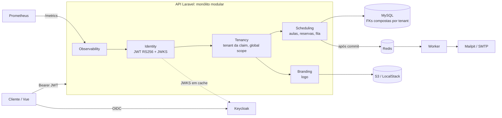

# saas-multitenant


SaaS multitenant de agendamento de aulas para estúdios de yoga e pilates. Domínio 100% fictício ("Estúdio Lótus Exemplo", "Pilates Equilíbrio Exemplo").

## O problema

Estúdios pequenos organizam a grade em planilhas e grupos de mensagem e convivem com os mesmos problemas: aula com mais alunos do que tapetes, aluno que reserva duas aulas no mesmo horário, vaga liberada em cima da hora que ninguém fica sabendo, cancelamento de última hora sem regra e confusão de horário entre fusos.

Esta API resolve isso para vários estúdios ao mesmo tempo, na mesma instalação:

- cada estúdio vê **somente os próprios** alunos, aulas e reservas;
- o admin cria **aulas recorrentes** ("terças e quintas às 07:00") no fuso do estúdio;
- o aluno **reserva**; com a aula cheia, entra na **lista de espera**;
- quando alguém cancela, o primeiro da fila é **promovido automaticamente** e recebe um e-mail;
- o aluno só cancela dentro da **janela de cancelamento** do estúdio; o admin pode cancelar depois;
- ninguém fica com **duas aulas no mesmo horário**, nem quando dois cliques chegam juntos;
- disputa pela **última vaga** tem exatamente um vencedor.

Núcleo, com roteiros de entrevista: [isolamento por tenant](docs/roteiros/isolamento-por-tenant.md) e [regras de agenda](docs/roteiros/regras-de-agenda.md).

## Arquitetura

Monólito modular em **Laravel 13 / PHP 8.4** (FrankenPHP), **MySQL 8.4**, **Keycloak** (OIDC), Redis (fila), S3 (LocalStack em dev) e Mailpit. Detalhes no [design doc](docs/design-doc.md).



| Módulo | Faz | Depende de |
| --- | --- | --- |
| `Tenancy` | `TenantContext`, `TenantScope` com falha fechada, guardas de escrita | Shared |
| `Identity` | Validação de JWT, JWKS com cache e rotação, papéis, provisionamento JIT | Shared, Tenancy |
| `Scheduling` | Recorrência no fuso, reserva com locks, fila, cancelamento, policies | Shared, Tenancy, Identity, Observability |
| `Branding` | Logo do estúdio no S3, prefixado por tenant | Shared, Tenancy, Identity |
| `Observability` | Correlação (`traceparent`, `X-Request-Id`), log de acesso JSON, métricas | Shared |

Fronteiras verificadas por teste (`tests/Unit/Architecture/ModuleBoundariesTest.php`).

### API (`/api/v1`, Bearer JWT)

| Método e rota | Quem | O que faz |
| --- | --- | --- |
| `GET /me` | todos | Usuário, papel e estúdio (fuso) |
| `POST /class-series` | admin | Cria aula recorrente e gera as ocorrências |
| `GET /sessions?from=&to=` | todos | Grade por datas locais do estúdio, com vagas e fila |
| `GET /sessions/{id}` | todos | Uma aula |
| `GET /sessions/{id}/bookings` | admin, instrutor da aula | Lista de presença e fila |
| `POST /sessions/{id}/bookings` | aluno | Reserva (confirmada ou fila) |
| `POST /bookings/{id}/cancel` | dono, admin | Cancela e promove o próximo da fila |
| `GET /me/bookings` | todos | Minhas reservas |
| `GET/POST /studio/logo` | todos / admin | Logo do estúdio |

Erros em `application/problem+json` com `type` estável (`overlapping_booking`, `cancellation_window_closed`, `already_booked`...). Fora da API: `GET /up` (health) e `GET /metrics` (Prometheus).

## Como rodar

Pré-requisitos: Docker 27+ e, para rodar testes no host, PHP 8.4 com `pdo_mysql`, `pcntl`, `posix` e Composer.

```bash
cp .env.example .env
composer install
php artisan key:generate
make up            # API, worker, MySQL, Redis, Keycloak, Mailpit, LocalStack
make ps
```

| Serviço | Endereço |
| --- | --- |
| API | http://localhost:8000 |
| Keycloak (admin / `dev-only-change-me`) | http://localhost:8080 |
| Mailpit | http://localhost:8025 |
| Prometheus (`make up-all`) | http://localhost:9090 |
| Adminer (`make up-all`) | http://localhost:8081 |

Usuários de exemplo do realm (senha `dev-only-change-me`): `admin.lotus@example.com`, `instrutor.lotus@example.com`, `aluna.lotus@example.com`, `aluna.beatriz.lotus@example.com`, `aluno.caio.lotus@example.com`, e os equivalentes `*.equilibrio@example.com`.

```bash
# token da aluna e a grade da semana
TOKEN=$(make -s token)
curl -s -H "Authorization: Bearer $TOKEN" http://localhost:8000/api/v1/me
curl -s -H "Authorization: Bearer $TOKEN" "http://localhost:8000/api/v1/sessions"

# como admin: criar uma aula recorrente com o instrutor seedado
ADMIN=$(KC_USER=admin.lotus@example.com make -s token)
INSTRUTOR=$(docker compose exec -T mysql mysql -ustudio -pdev-only-change-me studio -Nse \
  "select id from users where email='instrutor.lotus@example.com'")
curl -s -X POST http://localhost:8000/api/v1/class-series \
  -H "Authorization: Bearer $ADMIN" -H 'Content-Type: application/json' \
  -d "{\"title\":\"Hatha Yoga\",\"instructor_id\":\"$INSTRUTOR\",\"weekdays\":[2,4],\"start_time\":\"07:00\",\"duration_minutes\":60,\"capacity\":12,\"starts_on\":\"$(date +%F)\",\"ends_on\":\"$(date -v+30d +%F 2>/dev/null || date -d '+30 days' +%F)\"}"
```

Outros alvos: `make logs`, `make seed`, `make down`, `make clean`, `make network` + `make up-portfolio` (rede compartilhada `portfolio-net` com os outros projetos do portfólio). `make help` lista todos.

## Como testar

```bash
make test               # sobe só o MySQL e roda toda a suíte
make test-unit          # unitários (sem banco)
make test-integration   # integração com MySQL: isolamento, agenda, concorrência
make lint stan          # Pint e PHPStan (Larastan nível 8)
make check              # o mesmo que o CI
```

O que a suíte cobre (mais de 140 testes):

- **Isolamento**: pela API e pelo modelo, outro estúdio não lê nem altera nada (404), header de tenant forjado é ignorado, leitura sem tenant falha, a FK composta barra referência cruzada no banco.
- **Agenda**: recorrência no fuso (com horário de verão), capacidade, fila FIFO, promoção, janela de cancelamento ao segundo, dupla reserva, papéis.
- **Concorrência real**: 8 processos (`pcntl_fork`) disputam a última vaga contra o MySQL; um vence. Sem os locks, o teste falha.
- **JWT**: expirado, `alg: none`, confusão HS256, outra chave, `kid` desconhecido e rotação, `iss`/`aud` errados, JWKS fora do ar (tudo sem rede: `Http::fake`).

Os testes nunca chamam serviços externos: tokens são assinados com um par RSA gerado em memória; S3, fila e e-mail usam fakes.

## Evidência

Vídeo gravado com Playwright contra a stack real (Keycloak, MySQL, Redis, worker, Mailpit, Prometheus): login no Keycloak, aula com 2 vagas, lotação, lista de espera, promoção automática com e-mail, 404 entre estúdios, 401 sem token e métricas.

```bash
make evidencia   # sobe a stack, zera os dados de dev e roda e2e/evidencia
```

O vídeo fica em `e2e/evidencia/test-results/*/video.webm`.

## Decisões principais

| ADR | Decisão |
| --- | --- |
| [0001](docs/adr/0001-monolito-modular-em-laravel.md) | Monólito modular em Laravel, módulos por contexto, fronteiras testadas |
| [0002](docs/adr/0002-multitenancy-por-coluna-tenant-id.md) | Coluna `tenant_id` + global scope com falha fechada + FKs compostas (vs. banco e schema por tenant) |
| [0003](docs/adr/0003-autenticacao-oidc-keycloak-e-rbac.md) | Keycloak/OIDC, validação local RS256 com JWKS, JIT, RBAC por policies |
| [0004](docs/adr/0004-lock-pessimista-na-reserva.md) | Lock pessimista na reserva, ordem fixa de locks |
| [0005](docs/adr/0005-utc-no-banco-e-fuso-do-estudio.md) | UTC no banco, regras no fuso do estúdio, ocorrências materializadas |
| [0006](docs/adr/0006-infraestrutura-local-com-docker.md) | Compose com perfis, Redis, Mailpit, LocalStack (S3) |

## Trade-offs

- **Isolamento lógico, não físico**: barato e simples; depende de disciplina, compensada por falha fechada, FKs compostas e testes. Banco dedicado só para um eventual plano enterprise.
- **Lock pessimista**: reservas da mesma aula são serializadas. Irrelevante na escala de um estúdio; evolução para fila de pedidos se houver "drops" massivos.
- **Lista de espera bloqueia sobreposição**: o aluno não fica na fila de uma aula e confirmado em outra no mesmo horário. Perde flexibilidade, ganha garantia de que a promoção nunca cria dupla reserva.
- **Revogação de token não é imediata**: vale até expirar (15 min). Aceitável para agenda.
- **Ocorrências materializadas**: reservas por ocorrência e consultas simples, ao custo de um job de horizonte (ainda não feito).
- **Métricas sem `tenant_id`**: evita cardinalidade alta; análise por estúdio vem dos logs.

## Agenda: séries, cancelamento e e-mails

- **Horizonte**: séries criadas com `rolling: true` são estendidas até 90 dias à frente pelo comando `scheduling:maintain --horizon` (diário, serviço `scheduler` do compose), que despacha um job por estúdio na fila Redis. Idempotente.
- **Edição**: `PATCH /api/v1/sessions/{id}` com `scope` = `occurrence`, `following` ou `all` (admin). Título, instrutor e capacidade mudam sempre (capacidade nunca abaixo das vagas confirmadas; aumentar promove a fila); horário só muda em aulas sem reservas ativas. A resposta lista as aulas preservadas (`skipped`) e o motivo. "Esta e as próximas" divide a série em duas.
- **Cancelamento pelo estúdio**: `POST /api/v1/sessions/{id}/cancel` cancela a aula e as reservas e avisa por e-mail quem tinha vaga e quem estava na fila.
- **E-mails** pela fila Redis: confirmação de reserva, lembrete 24 h antes (`scheduling:maintain --reminders`, a cada 15 min), promoção da fila e cancelamento da aula.

## Próximos passos

1. Front-end **Vue 3** (OIDC + PKCE com o cliente `studio-web` já no realm).
2. Exportação de spans com **OpenTelemetry SDK** (hoje há propagação de `traceparent` e `trace_id` nos logs).
3. Export/import por tenant; usuário em vários estúdios com seleção no login.
4. Pacotes de aulas e pagamentos (integração com o processador de pagamentos do portfólio).
5. Smoke test da stack completa (`make up`) no CI. Nesta rodada foram validados localmente o `docker compose config`, a importação do realm e um login real no Keycloak validado pela API; o build da imagem e a subida de todos os serviços ficam a cargo do job `build` do CI.

## Licença

[MIT](LICENSE)
