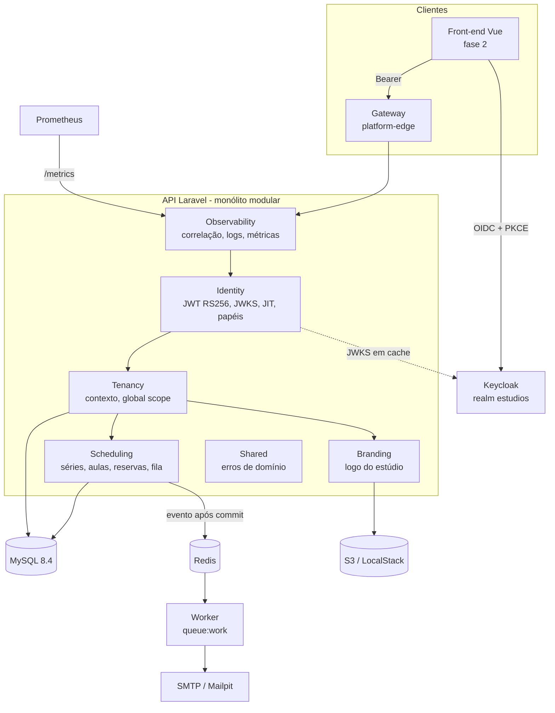
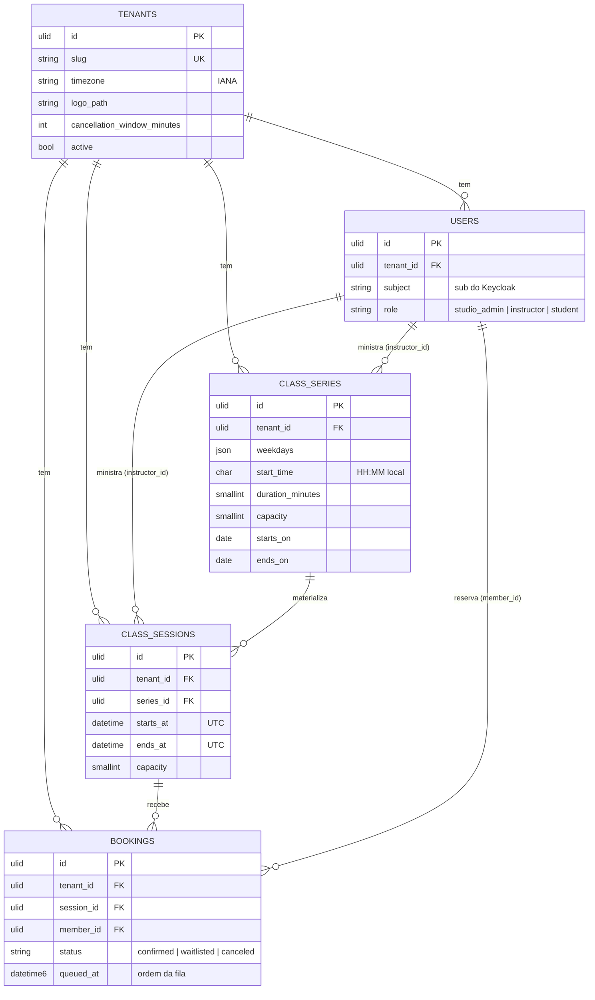
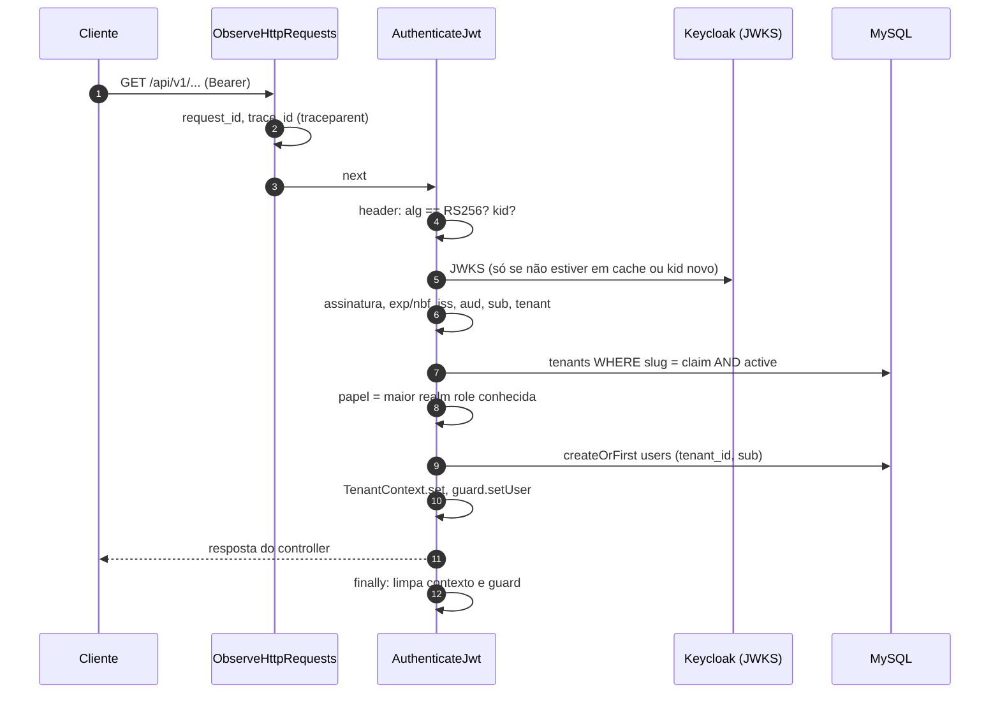

# Design doc: agenda multitenant para estúdios de yoga e pilates

- Autor: Johnny Santos
- Status: fundação implementada (fase 1)
- Última revisão: 2026-11-21

## 1. Contexto

Estúdios pequenos de yoga e pilates (exemplos fictícios: "Estúdio Lótus Exemplo" e "Pilates Equilíbrio Exemplo") organizam a grade em planilhas e grupos de mensagem. Os problemas recorrentes: aula lotada com gente a mais, aluno que reserva duas aulas no mesmo horário, vaga liberada em cima da hora que ninguém fica sabendo, cancelamentos de última hora sem regra clara e confusão de horário quando o estúdio e o aluno estão em fusos diferentes.

O produto é um SaaS: vários estúdios na mesma instalação, cada um vendo só os próprios dados.

## 2. Objetivos e não-objetivos

**Objetivos da fundação**

- Isolamento forte entre estúdios, provado por testes (lógico, pelo código e pelo banco).
- Agenda correta: aulas recorrentes no fuso do estúdio, capacidade, reserva, lista de espera com promoção automática, janela de cancelamento, bloqueio de dupla reserva e correção sob concorrência.
- Autenticação via Keycloak (OIDC), papéis admin/instrutor/aluno.
- API REST versionada (`/api/v1`), erros em Problem Details.
- Operável: logs estruturados, métricas Prometheus, correlação de requisições, ambiente local com um comando.

**Não-objetivos (por enquanto)**

- Créditos de aula e cobrança recorrente (o catálogo, o pedido e os eventos do processador existem, [ADR 0008](adr/0008-pacotes-de-aulas-e-eventos-de-pagamento.md); consumo, devolução, validade e estorno de créditos aguardam definição).
- Front-end completo (o Vue fica para a fase seguinte; o realm já tem o cliente `studio-web`).
- Banco dedicado por estúdio, multi-região.
- Preferências de notificação do aluno (e-mails de promoção, confirmação, lembrete e cancelamento já existem).
- Mudar os dias da semana de uma série existente.

## 3. Arquitetura

Monólito modular ([ADR 0001](adr/0001-monolito-modular-em-laravel.md)) em Laravel 13 / PHP 8.4, servido por FrankenPHP, com MySQL 8.4, Redis (fila e cache), Keycloak, Mailpit e S3 (LocalStack em dev).



Camadas em cada módulo: `Domain` (regras puras), `Application` (casos de uso, transações, locks), `Models` (Eloquent), `Policies`, `Http`. Dependências entre módulos verificadas por teste.

## 4. Modelo de dados



Restrições relevantes:

- `UNIQUE (tenant_id, subject)` em `users`; `UNIQUE (id, tenant_id)` em users, séries e aulas, alvo das **FKs compostas** `(x_id, tenant_id)`, que impedem no banco referências entre tenants.
- `UNIQUE (session_id, member_id)` em `bookings` (uma linha por aluno e aula; recancelar e reservar de novo reaproveita a linha).
- `CHECK (capacity > 0)`, `CHECK (ends_at > starts_at)`, `CHECK (status IN (...))`.
- Índices: `(tenant_id, starts_at)` na grade; `(session_id, status, queued_at)` para contagem e fila; `(member_id, status)` para sobreposição.
- IDs ULID: não enumeráveis e ordenáveis.

## 5. Fluxos principais

### 5.1 Autenticação e resolução do tenant



### 5.2 Reserva

Ver diagrama detalhado com locks em [roteiros/regras-de-agenda.md](roteiros/regras-de-agenda.md#2-fluxo-da-reserva-com-locks).

### 5.3 Cancelamento com promoção automática

```mermaid
sequenceDiagram
    autonumber
    participant A as Aluno/Admin
    participant P as BookingPolicy
    participant U as CancelBooking
    participant DB as MySQL
    participant Q as Redis (fila)
    participant W as Worker
    participant S as SMTP
    A->>P: POST /api/v1/bookings/{id}/cancel
    P-->>A: 403 se não é dono nem admin
    P->>U: autorizado
    U->>DB: BEGIN; aula FOR UPDATE; reserva FOR UPDATE
    U->>U: já cancelada? aula começou? janela (aluno)?
    U->>DB: UPDATE booking = canceled
    U->>DB: primeiro waitlisted ORDER BY queued_at, id FOR UPDATE
    U->>DB: UPDATE = confirmed
    U->>DB: COMMIT
    U->>Q: WaitlistPromoted (após commit)
    U-->>A: 200 {canceled, promoted}
    W->>Q: consome
    W->>W: runAs(tenant do evento)
    W->>DB: relê reserva (ainda confirmada?)
    W->>S: e-mail "sua vaga foi confirmada" (horário local)
```

### 5.4 Criação de aula recorrente

Admin envia dias da semana, horário local, duração, capacidade e período. `WeeklyRecurrence` valida e gera as ocorrências em UTC (data a data no fuso do estúdio); `CreateClassSeries` confere que o instrutor existe no tenant (consulta já filtrada) e grava série e aulas numa transação.

## 6. Falhas e como são tratadas

| Falha | Tratamento |
| --- | --- |
| Token ausente, expirado, mal assinado, `alg` errado, `iss`/`aud` errados | 401 genérico (`WWW-Authenticate: Bearer`); motivo no log (`jwt_rejected`) |
| Keycloak fora do ar | Chaves em cache seguem valendo (TTL 10 min); sem cache: 503 `identity_provider_unavailable` |
| `kid` desconhecido (rotação ou ataque) | Uma releitura do JWKS por intervalo mínimo (30 s); depois 401 |
| Tenant inexistente ou inativo | 403 `tenant_not_recognized` |
| Token sem papel do estúdio | 403 `role_not_recognized` |
| Código acessa dados sem tenant | `TenantContextMissing` → 500 e alerta (erro de programação, nunca vazamento) |
| Disputa pela última vaga | Lock pessimista; perdedores vão para a fila |
| Deadlock | Ordem única de locks; retry automático (3x) |
| Mesmo aluno, mesma aula, em paralelo | Lock do aluno; `UNIQUE` como última barreira → 409 `already_booked` |
| Regra violada | 409/422 com `type` estável (`overlapping_booking`, `cancellation_window_closed`, `session_already_started`...) |
| SMTP fora do ar | E-mail na fila com 3 tentativas; promoção já está commitada |
| Reserva cancelada antes do e-mail sair | Listener relê e não envia |
| Armazenamento de métricas indisponível | Aviso no log; requisição segue |
| Erro inesperado | 500 sem detalhes fora de `APP_DEBUG`; log com `request_id` e `trace_id` |

## 7. Segurança

- Autenticação delegada ao Keycloak; validação local de RS256 com allowlist de algoritmo e `kid` obrigatório ([ADR 0003](adr/0003-autenticacao-oidc-keycloak-e-rbac.md)).
- Tenant só da claim assinada; isolamento em camadas e falha fechada ([ADR 0002](adr/0002-multitenancy-por-coluna-tenant-id.md)).
- RBAC por policies; 404 para recurso de outro tenant (evita enumeração); ULIDs.
- Upload de logo: só PNG/JPG/WEBP (SVG recusado por risco de XSS), limite de tamanho, bucket privado com acesso público bloqueado, entrega pela própria API.
- `X-Request-Id` aceito só com caracteres seguros (evita injeção em header e log).
- Contêiner sem root; segredos fora do repositório (`.env` ignorado; compose usa senhas `dev-only-change-me`).
- `/metrics` sem autenticação: deve ser exposto só na rede interna (bloqueado no gateway).

## 8. Observabilidade

- **Logs**: JSON em stderr (canal `json`), uma linha por evento. Contexto compartilhado via `Context` do Laravel: `request_id`, `trace_id`, `tenant_id`, `user_id`. Eventos: `http_request` (método, rota-modelo, status, duração), `booking_created`, `booking_canceled`, `class_series_created`, `jwt_rejected`, `metrics_storage_failed`.
- **Correlação/trace**: aceita `traceparent` (W3C) e `X-Request-Id` do gateway, ou gera novos; devolve `X-Request-Id` e `X-Trace-Id`. Spans via OpenTelemetry SDK exportados por OTLP/HTTP ([ADR 0007](adr/0007-opentelemetry-sdk-e-exportacao-otlp.md)): span do request com o `traceparent` como pai e spans dos casos de uso de reserva e cancelamento; o `trace_id` dos logs é o do span.
- **Métricas Prometheus** (`/metrics`, APCu entre workers):
  - `saas_http_requests_total{method,route,status}` e `saas_http_request_duration_seconds` (histograma) — RED por rota-modelo, sem IDs nos rótulos;
  - `saas_bookings_total{result}` (`confirmed`, `waitlisted`, `rejected_overlapping_booking`, ...);
  - `saas_waitlist_promotions_total`.
- Prometheus no perfil `observability` do compose. Sem `tenant_id` como rótulo para não explodir cardinalidade; análises por estúdio saem dos logs.

## 9. Alternativas consideradas

| Tema | Escolha | Alternativas | ADR |
| --- | --- | --- | --- |
| Arquitetura | Monólito modular | Microsserviços, Laravel padrão, Hyperf | 0001 |
| Multitenancy | Coluna + scope + FKs compostas | Banco por tenant, schema por tenant, RLS | 0002 |
| Auth | Keycloak + validação local | Sanctum/Passport, introspecção | 0003 |
| Concorrência | Lock pessimista | Assentos com UNIQUE, contador atômico, otimista, Redis, SERIALIZABLE | 0004 |
| Tempo | UTC + fuso do estúdio + materialização | Hora local, RRULE em leitura | 0005 |
| Infra local | Compose com perfis, LocalStack, Mailpit, Redis | MinIO, SES local, fila no banco | 0006 |
| Pacotes | Pedido com `payment_id` próprio + eventos do processador | Consultar o processador, créditos já | 0008 |
| Traces | OTel SDK + OTLP/HTTP | Extensão com auto-instrumentação, gRPC | 0007 |

## 10. Plano de evolução

1. **Front-end Vue 3** com login OIDC + PKCE (cliente `studio-web`), grade semanal no fuso do estúdio e "minhas reservas".
2. ~~Job de horizonte e edição de série~~ (entregue: `scheduling:maintain`, `PATCH /sessions/{id}`).
3. ~~Cancelamento de aula pelo estúdio~~ (entregue).
4. ~~E-mails de confirmação e lembrete~~ (entregue); preferências do aluno ficam para depois.
5. ~~OpenTelemetry SDK exportando spans~~ (entregue; ADR 0007).
6. ~~Teste de arquitetura de `BelongsToTenant`~~ (entregue: `TenantModelsTest`).
7. **Export/import por tenant** (restauração isolada, portabilidade).
8. **Usuário em vários estúdios** com seleção de estúdio no login.
9. **Planos e pacotes de aulas**: catálogo, pedido e consumo dos eventos do processador entregues (ADR 0008); **créditos** (concessão, consumo, devolução, validade, estorno) pendentes de decisão.
10. **Rate limit por tenant** no gateway e quotas por plano.
