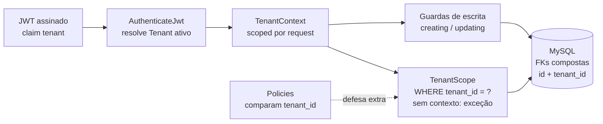

# Roteiro: isolamento por tenant

Objetivo: conseguir explicar, desenhar e defender numa entrevista como um estúdio nunca enxerga nem altera dados de outro.

## 1. O problema em uma frase

Vários estúdios compartilham o mesmo banco e as mesmas tabelas; qualquer `SELECT` esquecido sem `WHERE tenant_id = ?` vira vazamento de lista de alunos.

## 2. A solução em camadas

| Camada | Onde no código | O que impede |
| --- | --- | --- |
| Origem do tenant | `Identity/Http/Middleware/AuthenticateJwt.php` | Cliente escolher o tenant (header, subdomínio, query) |
| Contexto por request | `Tenancy/TenantContext.php` (scoped) e `finally` no middleware | Tenant de um request vazar para o próximo (Octane, testes) |
| Leitura | `Tenancy/Scopes/TenantScope.php` | `find`, `where`, `update` em massa sem filtro |
| Falha fechada | `TenantScope` chama `current()`, que lança `TenantContextMissing` | Job ou comando sem tenant ler tudo |
| Escrita | `Tenancy/Concerns/BelongsToTenant.php` | Criar linha em outro tenant; mover linha de tenant |
| Banco | FKs `(session_id, tenant_id) -> class_sessions(id, tenant_id)` etc. | Reserva do tenant A apontar para aula do tenant B |
| Autorização | `Scheduling/Policies/*` comparam `tenant_id` | Registro de outro tenant que escapasse do scope |
| Resposta | 404 para recurso de outro tenant | Enumeração (confirmar que um ID existe) |
| Armazenamento | `Branding/LogoStorage.php` monta `tenants/{id}/...`; rota sem ID | Ler o logo de outro estúdio |
| Filas | `WaitlistPromoted` carrega `tenantId`; listener usa `runAs` | Job rodar sem tenant ou com o errado |

## 3. Como está provado

- `tests/Feature/Tenancy/TenantIsolationApiTest.php`: pela API, o estúdio B tenta ler a aula, a lista de presença, reservar, cancelar e agendar com instrutor do estúdio A. Tudo 404/422 e nada muda no banco. Também: header `X-Tenant` forjado é ignorado; mesmo `sub` em dois estúdios vira dois usuários; tenant desconhecido ou inativo dá 403.
- `tests/Feature/Tenancy/TenantScopeTest.php`: scope filtra, `find` não atravessa, leitura sem contexto falha, criação cruzada falha, troca de `tenant_id` falha, `update` em massa respeita o scope, `runAs` restaura o contexto mesmo com exceção, e a FK composta barra uma reserva cruzada inserida com `withoutTenancy()`.
- `tests/Unit/Scheduling/PolicyTest.php`: policies negam usuário de outro tenant.
- `tests/Feature/Branding/StudioLogoTest.php` e `WaitlistPromotionEmailTest.php`: isolamento no S3 e na fila.

## 4. Alternativas e trade-offs

Ver [ADR 0002](../adr/0002-multitenancy-por-coluna-tenant-id.md). Resumo: banco por tenant isola mais e custa muito mais; schema por tenant no MySQL é praticamente banco por tenant; coluna é barata e simples, desde que as camadas acima existam e sejam testadas.

## 5. Perguntas de entrevista (com respostas)

**Por que não banco por tenant, se é mais seguro?**
Porque o cliente-alvo é um estúdio pequeno: um banco por tenant multiplica custo, conexões, backups e migrations. Compensamos o isolamento lógico com falha fechada, FKs compostas e testes de isolamento. Para um cliente enterprise que exija, dá para resolver a conexão por tenant sem mudar os modelos.

**O que acontece se alguém esquecer o trait num modelo novo?**
O modelo fica sem scope, esse é o risco real. Mitigações: o checklist do PR, a FK composta (a tabela nova precisa de `tenant_id` para referenciar as outras) e testes de isolamento por recurso. Próximo passo: um teste que percorre os modelos e exige o trait em toda tabela com coluna `tenant_id`.

**Por que lançar exceção sem tenant em vez de não filtrar?**
"Sem tenant, sem filtro" é exatamente como jobs e comandos vazam dados. Com falha fechada o erro aparece no primeiro teste. Quem precisa atravessar tenants escreve `withoutTenancy()`, explícito e fácil de auditar.

**Por que 404 e não 403 para recurso de outro estúdio?**
403 confirma que o ID existe. Com ULIDs isso já é difícil, mas 404 não dá informação nenhuma. Dentro do próprio estúdio, falta de papel é 403.

**De onde vem o tenant? E se o usuário trocar o header?**
Só da claim `tenant` do token assinado pelo Keycloak (mapper de atributo do usuário). Headers e parâmetros são ignorados, e há teste para isso.

**Como o tenant não vaza entre requests num worker de longa duração (Octane, FrankenPHP worker mode)?**
`TenantContext` é registrado como `scoped`, o middleware limpa contexto e guard no `finally`, e o scope resolve o contexto a cada consulta (não no boot do modelo).

**E nos jobs de fila?**
Não há request, logo não há contexto. O evento carrega `tenantId` e o listener faz `runAs($tenant, ...)`. Se esquecer, a primeira consulta lança `TenantContextMissing`.

**Um usuário pode estar em dois estúdios?**
Sim, como duas linhas em `users` (uma por tenant, unique `tenant_id + subject`), cada uma com seu papel. O token carrega um tenant por vez; trocar de estúdio é pedir outro token (no Keycloak, um atributo multivalorado com seleção na tela de login, em próximos passos).

**E vizinho barulhento?**
Índices começam por `tenant_id`, listagens são paginadas e com intervalo máximo de 31 dias. Rate limit por tenant fica no gateway (`platform-edge`).

**Como restaurar os dados de um único estúdio?**
Hoje exigiria export filtrado por `tenant_id`. Está nos próximos passos como comando de export/import por tenant.
