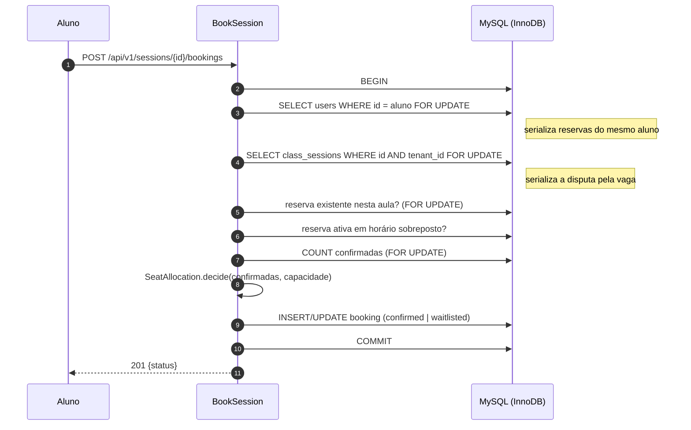

# Roteiro: regras de agenda

Objetivo: explicar e defender as regras de reserva (capacidade, lista de espera, janela de cancelamento, dupla reserva, fuso) e como elas continuam corretas sob concorrência.

## 1. Regras de negócio

| Regra | Onde | Comportamento |
| --- | --- | --- |
| Aulas recorrentes | `Domain/WeeklyRecurrence.php`, `Application/CreateClassSeries.php` | Dias da semana + horário local + duração; ocorrências materializadas em UTC, até 183 dias |
| Fuso do estúdio | `tenants.timezone`, `WeeklyRecurrence`, `SessionResource` | 07:00 local é sempre 07:00 local, inclusive no horário de verão; API devolve UTC e local |
| Capacidade | `Domain/SeatAllocation.php` | Confirmada se `confirmadas < capacidade`, senão lista de espera |
| Reserva | `Application/BookSession.php` | Só aluno; aula ainda não começou; uma reserva ativa por aula |
| Dupla reserva | `BookSession::hasOverlappingBooking` | Bloqueia outra reserva ativa (confirmada ou na fila) que cruze o horário; aulas encostadas (fim = início) são permitidas |
| Lista de espera | `queued_at` (microssegundos) + `id` | FIFO |
| Promoção automática | `Application/CancelBooking.php` | Ao cancelar uma vaga confirmada, o primeiro da fila é confirmado na mesma transação; e-mail sai depois do commit, pela fila |
| Janela de cancelamento | `Domain/CancellationWindow.php`, `tenants.cancellation_window_minutes` | Aluno cancela vaga confirmada até `início - janela`; dentro da janela só o admin; sair da fila é sempre permitido; ninguém cancela depois do início |
| Concorrência na última vaga | Locks em `BookSession`, [ADR 0004](../adr/0004-lock-pessimista-na-reserva.md) | Um vence, os outros vão para a fila |

## 2. Fluxo da reserva com locks

Ordem dos locks em todo o código: aluno, aula, reservas. O cancelamento trava aula e reservas (nunca o aluno). Sem ciclo, sem deadlock; mesmo assim a transação repete até 3 vezes em deadlock.

## 3. Como está provado

- Unitários sem banco: `WeeklyRecurrenceTest` (dias, UTC, horário de verão de Lisboa, horário inexistente, entradas inválidas, horizonte máximo), `CancellationWindowTest` (antes, exatamente no prazo, janela zero), `SeatAllocationTest`, `PolicyTest`.
- Integração com MySQL: `BookingTest` (vaga, fila, duplicada, rebook reaproveita a linha, sobreposição, fila também bloqueia sobreposição, aulas encostadas, aula iniciada, papéis, ordem por microssegundos, métricas), `CancellationAndWaitlistTest` (prazo ao segundo, admin dentro da janela, sair da fila, promoção FIFO com evento, cancelamento duplo, dono/instrutor), `CreateClassSeriesTest` (UTC no banco, horário local na API, filtro por dia local), `RosterAccessTest`, `WaitlistPromotionEmailTest`.
- Concorrência real: `BookingConcurrencyTest` usa `pcntl_fork` com 8 processos e conexões próprias, liberados no mesmo instante. Verifica 1 confirmado e 7 na fila, e que o mesmo aluno não ganha duas aulas no mesmo horário. Removendo os `lockForUpdate`, o teste falha.

## 4. Trade-offs principais

- **Lock pessimista vs. alternativas**: ver ADR 0004. Escolhido por ser simples de provar; o custo (serializar reservas da mesma aula) é irrelevante na escala de um estúdio.
- **Fila bloqueia sobreposição**: um aluno não pode ficar na fila da aula das 7h e confirmado em outra das 7h. Perde-se flexibilidade ("fico na fila da minha preferida"), mas a promoção automática nunca gera dupla reserva. Evolução possível: promoção que pula quem ficaria sobreposto.
- **Promoção dentro da janela**: quem é promovido a 1h da aula fica com vaga confirmada e não pode cancelar sozinho. Alternativa futura: janela só para quem foi promovido antes do prazo, ou exigir confirmação do promovido.
- **Materializar ocorrências**: permite capacidade e reservas por ocorrência; exige job para estender o horizonte e política de edição da série.

## 5. Perguntas de entrevista (com respostas)

**Duas pessoas clicam na última vaga no mesmo milissegundo. O que acontece?**
As duas transações tentam `SELECT ... FOR UPDATE` na linha da aula; a segunda espera. A primeira conta as confirmadas, confirma e faz commit. A segunda acorda, conta de novo (leitura travada, vê o commit), encontra a aula cheia e entra na fila. O teste com fork prova isso com 8 processos.

**Por que a contagem também usa FOR UPDATE se a aula já está travada?**
No REPEATABLE READ, uma leitura comum usa o snapshot criado na primeira leitura não travada da transação. Leituras travadas sempre leem o último commit. Assim a correção não depende de onde o snapshot nasceu nem do nível de isolamento.

**Por que não só uma UNIQUE constraint?**
Ela existe (`session_id, member_id`) e barra a mesma pessoa duas vezes na mesma aula. Mas capacidade é contagem, e contagem não cabe numa UNIQUE sem modelar assentos; dupla reserva entre aulas diferentes também não.

**Como evitar que a mesma aluna reserve duas aulas no mesmo horário em duas abas?**
Cada aba trava uma aula diferente, então o lock da aula não basta. Por isso o primeiro lock é na linha do aluno: as duas reservas dele ficam em série e a segunda enxerga a primeira na checagem de sobreposição.

**E deadlock?**
Todo caminho trava na mesma ordem (aluno, aula, reservas); o cancelamento começa pela aula. Sem ordem circular. Se o InnoDB ainda assim detectar um, `DB::transaction(..., 3)` repete.

**Por que a promoção acontece na mesma transação do cancelamento?**
Para não existir um instante com vaga livre e gente esperando, em que um terceiro "furaria" a fila. O e-mail, por outro lado, sai depois do commit (`ShouldDispatchAfterCommit`) e pela fila: falha de SMTP não desfaz a promoção, e promoção desfeita não gera e-mail.

**Como a ordem da fila é garantida?**
`queued_at` com microssegundos (`DATETIME(6)`) e desempate por `id` (ULID). Quem entra na fila faz isso com a aula travada, então os `queued_at` saem em ordem.

**Como funciona o fuso? E o horário de verão?**
A recorrência é gerada data a data: "data local + 07:00" no fuso do estúdio, convertido para UTC. Há teste com Lisboa atravessando a mudança de horário: o UTC muda de 07:00 para 06:00 e o horário local fica 07:00. Horário que não existe (01:30 no salto) avança para 02:30.

**Por que o filtro da grade usa datas locais?**
Uma aula às 22:30 de segunda em São Paulo é terça em UTC. Quem pede "segunda" quer a aula de segunda. O request converte o dia local em intervalo UTC (há teste).

**O que é a janela de cancelamento exatamente?**
`prazo = início - janela do estúdio`. O aluno cancela enquanto `agora < prazo` (no instante do prazo, já está fechada). Vale só para vaga confirmada; sair da fila é sempre permitido porque não prejudica ninguém. O admin pode cancelar dentro da janela (por exemplo, aluno doente), mas ninguém cancela aula iniciada.

**Como isso escala?**
O gargalo é a linha da aula: transações de poucos milissegundos suportam centenas de reservas por segundo por aula. Aulas diferentes não competem. Se um dia houver "drops" com milhares de pessoas por vaga, a evolução é uma fila de pedidos de reserva processada por aula, com o mesmo modelo de dados.
